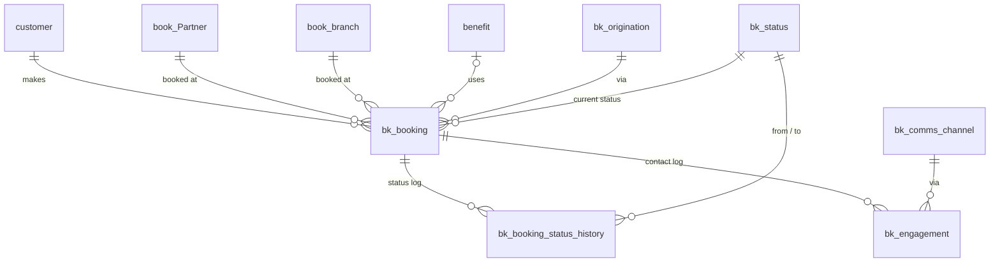

# Booking Component (v2)

Replaces the current booking flow (`app/routers/booking.py`, `book_booking`).
All new tables are prefixed `bk_`. Database: **GOR** (`GOR_CONNECTION`).

**Status:** Phase 1: DB design (planning, not yet applied)

---

## 1. Existing tables we reference (read-only, no changes)

| Table | PK | Notes |
|---|---|---|
| `customer` | `id int` | 259k rows |
| `benefit` | `id int` | 99 rows |
| `book_Partner` | `id int` | `isActive bit` |
| `book_branch` | `id int` | `partner_id` FK → `book_Partner.id`, `is_active bit` |

Legacy (to be replaced): `book_booking` (14 rows), `book_booking_tug`, `booking_type` (empty).
`spBookingNew` (called by `booking.py`) does **not** exist in GOR DB. Needs checking.

---

## 2. Design decisions

1. **Lookup tables for status / origination / comms channel.** No free-text values, so reports group cleanly and new values don't need code changes.
2. **Booking reference.** `id` is the internal identity. `booking_ref` is a persisted computed column (`BK000123`), so it's unique, human-readable, and quotable on the phone or WhatsApp. No extra sequence logic needed.
3. **Current status is held on `bk_booking`** (`status_id`, `status_changed_at`) for fast filtering. **Every change is logged** in `bk_booking_status_history` with `from_status_id` → `to_status_id`, so the latest history row alone gives *current, previous, date changed*.
4. **Status changes only go through a stored procedure** (`spBkBookingSetStatus`), which updates the booking and writes history in one transaction. The app never `UPDATE`s `status_id` directly.
5. **Redemption date is derived, not stored.** It's the `changed_at` of the history row where status became *Redeemed* or *Discount Redeemed*, exposed via the report view. This avoids two sources of truth.
6. **Customer feedback lives on the booking** (`feedback_rating`, `feedback_text`, `feedback_date`). It's one per booking and about that experience. The engagement log records the touchpoint where it was captured.
7. **Engagement is a log** (`bk_engagement`), one row per contact. *Last comms date / channel* = latest row. *Next follow-up* = latest row's `next_follow_up_date`.
8. **Branch must belong to the selected partner.** This is enforced in `spBkBookingCreate` and avoids altering `book_branch`. (Alternative: unique index on `book_branch(id, partner_id)` + composite FK. Stricter, but touches an existing table.)
9. **Dates:** `datetime2(0)` with `GETDATE()` defaults (local time, consistent with existing app data).
10. **Money:** `decimal(12,2)`, currency assumed ZAR.

---

## 3. Entity diagram



---

## 4. Tables

### `bk_status` (lookup, seeded)
| id | code | name | is_terminal |
|---|---|---|---|
| 1 | NEW | New | 0 |
| 2 | STAGNATE | Stagnate | 0 |
| 3 | CANCELLED | Cancelled | 1 |
| 4 | ISSUED | Issued | 0 |
| 5 | REDEEMED | Redeemed | 1 |
| 6 | LAPSED | Booking Lapsed | 1 |
| 7 | DISC_REDEEMED | Discount Redeemed | 1 |

### `bk_origination` (lookup, seeded)
1 Booking Form · 2 Call In · 3 WhatsApp

### `bk_comms_channel` (lookup, seeded)
1 Email · 2 Voice · 3 WhatsApp

### `bk_booking`
| Column | Type | Null | Notes |
|---|---|---|---|
| id | int identity | N | PK |
| booking_ref | computed, persisted | N | `'BK' + RIGHT('000000'+id,6)`, unique |
| customer_id | int | N | FK `customer.id` |
| booking_datetime | datetime2(0) | N | date + time of the booking |
| partner_id | int | N | FK `book_Partner.id` |
| branch_id | int | N | FK `book_branch.id` (must belong to partner) |
| benefit_id | int | Y | FK `benefit.id` |
| origination_id | int | N | FK `bk_origination.id` |
| booking_details | nvarchar(max) | Y | |
| value_saving | decimal(12,2) | Y | ZAR |
| status_id | int | N | FK `bk_status.id`, default 1 (New) |
| status_changed_at | datetime2(0) | N | mirrors latest history row |
| feedback_rating | tinyint | Y | 1–5 |
| feedback_text | nvarchar(1000) | Y | |
| feedback_date | datetime2(0) | Y | |
| created_at | datetime2(0) | N | default GETDATE() |
| created_by | nvarchar(100) | Y | admin user / 'customer' |
| updated_at | datetime2(0) | Y | |

### `bk_booking_status_history`
| Column | Type | Null | Notes |
|---|---|---|---|
| id | int identity | N | PK |
| booking_id | int | N | FK `bk_booking.id` |
| from_status_id | int | Y | NULL on the initial *New* row |
| to_status_id | int | N | |
| changed_at | datetime2(0) | N | default GETDATE() |
| changed_by | nvarchar(100) | Y | |
| note | nvarchar(500) | Y | reason, e.g. cancellation reason |

### `bk_engagement`
| Column | Type | Null | Notes |
|---|---|---|---|
| id | int identity | N | PK |
| booking_id | int | N | FK `bk_booking.id` |
| customer_id | int | N | FK `customer.id` (denormalised for customer-level reporting) |
| channel_id | int | N | FK `bk_comms_channel.id` |
| comms_date | datetime2(0) | N | default GETDATE() |
| notes | nvarchar(1000) | Y | |
| next_follow_up_date | date | Y | |
| created_by | nvarchar(100) | Y | |

---

## 5. Stored procedures (planned)

| SP | Purpose |
|---|---|
| `spBkBookingCreate` | Validates branch ∈ partner, inserts booking (status New), writes initial history row (NULL → New). Returns `id`, `booking_ref`. |
| `spBkBookingSetStatus` | `@booking_id, @status_id, @changed_by, @note`. Updates booking + inserts history in a transaction. No-op if unchanged. |
| `spBkEngagementAdd` | Logs a contact + next follow-up date. |
| `spBkBookingFeedback` | Sets rating / text / feedback_date. |
| `spBkBookingGet` | Booking + status history + engagement (multiple result sets → `generic_fetch_multiple_datasets`). |
| `spBkBranchesForPartner` | Active branches for the partner dropdown (HTMX cascade). |

## 6. Report view (planned): `vw_bk_booking_report`

One row per booking: ref, customer, partner, branch, benefit, origination, value saving,
**current status, previous status, status changed date**, redemption date (derived),
feedback, **last comms date, last comms channel, next follow-up date**.

---

## 7. Draft DDL

```sql
-- Lookups
CREATE TABLE dbo.bk_status (
    id          int           NOT NULL PRIMARY KEY,
    code        varchar(20)   NOT NULL UNIQUE,
    name        nvarchar(50)  NOT NULL,
    is_terminal bit           NOT NULL DEFAULT 0,
    sort_order  int           NOT NULL DEFAULT 0
);
INSERT dbo.bk_status (id, code, name, is_terminal, sort_order) VALUES
 (1,'NEW','New',0,1),(2,'STAGNATE','Stagnate',0,2),(3,'CANCELLED','Cancelled',1,3),
 (4,'ISSUED','Issued',0,4),(5,'REDEEMED','Redeemed',1,5),(6,'LAPSED','Booking Lapsed',1,6),
 (7,'DISC_REDEEMED','Discount Redeemed',1,7);

CREATE TABLE dbo.bk_origination (
    id   int          NOT NULL PRIMARY KEY,
    name nvarchar(50) NOT NULL UNIQUE
);
INSERT dbo.bk_origination VALUES (1,'Booking Form'),(2,'Call In'),(3,'WhatsApp');

CREATE TABLE dbo.bk_comms_channel (
    id   int          NOT NULL PRIMARY KEY,
    name nvarchar(50) NOT NULL UNIQUE
);
INSERT dbo.bk_comms_channel VALUES (1,'Email'),(2,'Voice'),(3,'WhatsApp');

-- Booking
CREATE TABLE dbo.bk_booking (
    id                int IDENTITY(1,1) NOT NULL CONSTRAINT PK_bk_booking PRIMARY KEY,
    booking_ref       AS ('BK' + RIGHT('000000' + CAST(id AS varchar(10)), 6)) PERSISTED,
    customer_id       int            NOT NULL CONSTRAINT FK_bk_booking_customer    REFERENCES dbo.customer(id),
    booking_datetime  datetime2(0)   NOT NULL,
    partner_id        int            NOT NULL CONSTRAINT FK_bk_booking_partner     REFERENCES dbo.book_Partner(id),
    branch_id         int            NOT NULL CONSTRAINT FK_bk_booking_branch      REFERENCES dbo.book_branch(id),
    benefit_id        int            NULL     CONSTRAINT FK_bk_booking_benefit     REFERENCES dbo.benefit(id),
    origination_id    int            NOT NULL CONSTRAINT FK_bk_booking_origination REFERENCES dbo.bk_origination(id),
    booking_details   nvarchar(max)  NULL,
    value_saving      decimal(12,2)  NULL,
    status_id         int            NOT NULL CONSTRAINT DF_bk_booking_status DEFAULT 1
                                              CONSTRAINT FK_bk_booking_status      REFERENCES dbo.bk_status(id),
    status_changed_at datetime2(0)   NOT NULL CONSTRAINT DF_bk_booking_status_changed DEFAULT GETDATE(),
    feedback_rating   tinyint        NULL CONSTRAINT CK_bk_booking_rating CHECK (feedback_rating BETWEEN 1 AND 5),
    feedback_text     nvarchar(1000) NULL,
    feedback_date     datetime2(0)   NULL,
    created_at        datetime2(0)   NOT NULL CONSTRAINT DF_bk_booking_created DEFAULT GETDATE(),
    created_by        nvarchar(100)  NULL,
    updated_at        datetime2(0)   NULL
);
CREATE UNIQUE INDEX UX_bk_booking_ref       ON dbo.bk_booking(booking_ref);
CREATE INDEX IX_bk_booking_customer         ON dbo.bk_booking(customer_id);
CREATE INDEX IX_bk_booking_status           ON dbo.bk_booking(status_id, booking_datetime);
CREATE INDEX IX_bk_booking_partner_branch   ON dbo.bk_booking(partner_id, branch_id);

-- Status history
CREATE TABLE dbo.bk_booking_status_history (
    id             int IDENTITY(1,1) NOT NULL CONSTRAINT PK_bk_booking_status_history PRIMARY KEY,
    booking_id     int           NOT NULL CONSTRAINT FK_bk_bsh_booking REFERENCES dbo.bk_booking(id),
    from_status_id int           NULL     CONSTRAINT FK_bk_bsh_from    REFERENCES dbo.bk_status(id),
    to_status_id   int           NOT NULL CONSTRAINT FK_bk_bsh_to      REFERENCES dbo.bk_status(id),
    changed_at     datetime2(0)  NOT NULL CONSTRAINT DF_bk_bsh_changed DEFAULT GETDATE(),
    changed_by     nvarchar(100) NULL,
    note           nvarchar(500) NULL
);
CREATE INDEX IX_bk_bsh_booking ON dbo.bk_booking_status_history(booking_id, changed_at DESC);

-- Engagement
CREATE TABLE dbo.bk_engagement (
    id                  int IDENTITY(1,1) NOT NULL CONSTRAINT PK_bk_engagement PRIMARY KEY,
    booking_id          int            NOT NULL CONSTRAINT FK_bk_eng_booking  REFERENCES dbo.bk_booking(id),
    customer_id         int            NOT NULL CONSTRAINT FK_bk_eng_customer REFERENCES dbo.customer(id),
    channel_id          int            NOT NULL CONSTRAINT FK_bk_eng_channel  REFERENCES dbo.bk_comms_channel(id),
    comms_date          datetime2(0)   NOT NULL CONSTRAINT DF_bk_eng_date DEFAULT GETDATE(),
    notes               nvarchar(1000) NULL,
    next_follow_up_date date           NULL,
    created_by          nvarchar(100)  NULL
);
CREATE INDEX IX_bk_eng_booking  ON dbo.bk_engagement(booking_id, comms_date DESC);
CREATE INDEX IX_bk_eng_followup ON dbo.bk_engagement(next_follow_up_date) WHERE next_follow_up_date IS NOT NULL;
```

---

## 8. Open questions

1. **Benefit:** is it required on every booking, or optional (e.g. a booking with no benefit applied)? Drafted as optional.
2. **Branch:** does every partner have at least one branch (incl. voucher-only partners)? Drafted as required.
3. **Status rules:** should transitions be restricted (e.g. no change once Cancelled / Redeemed), or is any change allowed by admins?
4. **Automation:** should *Stagnate* / *Booking Lapsed* be set automatically by a scheduled job (e.g. N days past `booking_datetime` with no redemption)? If so, what N?
5. **Engagement scope:** is contact always about a specific booking, or can we log customer-level contact with no booking? (If so, `booking_id` becomes nullable.)
6. **Legacy data:** migrate the 14 `book_booking` rows into `bk_booking`, or start clean?
7. **Who's acting:** should `created_by` / `changed_by` record the admin username from the login cookie?

---

## 9. Phases

- [ ] **Phase 1: DB**: finalise design → apply DDL → seed lookups ← *current*
- [ ] Phase 2: Stored procedures + report view
- [ ] Phase 3: Router (`bk_booking.py`) + DAL calls
- [ ] Phase 4: Templates (create form w/ partner→branch HTMX cascade, booking detail, status change, engagement log)
- [ ] Phase 5: Reports, cut over from `booking.py`, retire legacy tables

## Changelog

- 2026-10-21: Initial DB design drafted.
